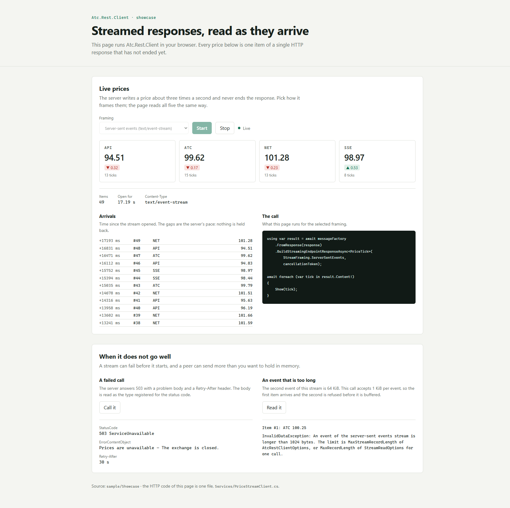

[](https://www.nuget.org/packages/atc.rest.client)

# 🌐 ATC.Net REST Client

A lightweight and flexible REST client library for .NET, providing a clean abstraction over HttpClient with built-in support for request building, response handling, and dependency injection.

## 📚 Table of Contents

- [🌐 ATC.Net REST Client](#-atcnet-rest-client)
  - [📚 Table of Contents](#-table-of-contents)
  - [✨ Features](#-features)
  - [🚀 Getting Started](#-getting-started)
    - [📦 Installation](#-installation)
    - [⚙️ Service Registration](#️-service-registration)
      - [Approach 1: Core Services Only (No HttpClient Configuration)](#approach-1-core-services-only-no-httpclient-configuration)
      - [Approach 2: Direct Configuration](#approach-2-direct-configuration)
      - [Approach 3: Custom Options Type](#approach-3-custom-options-type)
      - [✂️ Trimming and Native AOT](#️-trimming-and-native-aot)
    - [🔌 Creating an Endpoint](#-creating-an-endpoint)
  - [💡 Usage Examples](#-usage-examples)
    - [📥 Simple GET Request](#-simple-get-request)
    - [📤 POST Request with Body](#-post-request-with-body)
    - [🔗 Using Path and Query Parameters](#-using-path-and-query-parameters)
    - [📎 File Upload (Multipart Form Data)](#-file-upload-multipart-form-data)
    - [📝 URL-Encoded Form Body](#-url-encoded-form-body)
    - [📁 File Upload with IFileContent](#-file-upload-with-ifilecontent)
    - [📤 Binary Upload (Raw Stream)](#-binary-upload-raw-stream)
    - [💾 File Download (Binary Response)](#-file-download-binary-response)
    - [🌊 Streaming Responses (IAsyncEnumerable)](#-streaming-responses-iasyncenumerable)
      - [Option 1: Simple Streaming (Basic Usage)](#option-1-simple-streaming-basic-usage)
      - [Option 2: Managed Lifecycle Streaming (Recommended) ✨](#option-2-managed-lifecycle-streaming-recommended-)
      - [Typed Errors and Headers of a Streamed Response](#typed-errors-and-headers-of-a-streamed-response)
      - [A Result Class for a Streamed Response](#a-result-class-for-a-streamed-response)
    - [🧱 Supported Stream Formats](#-supported-stream-formats)
      - [On the Wire](#on-the-wire)
      - [Rules of the Readers](#rules-of-the-readers)
      - [The Limit on One Record](#the-limit-on-one-record)
    - [📡 Server-Sent Events](#-server-sent-events)
      - [Resuming an Event Stream](#resuming-an-event-stream)
    - [📋 Handling Responses](#-handling-responses)
      - [Success and Error Response Handling](#success-and-error-response-handling)
      - [Custom Response Processing](#custom-response-processing)
      - [Plain Text Responses](#plain-text-responses)
      - [The Default Response and Responses per Media Type](#the-default-response-and-responses-per-media-type)
      - [Error Response Deserialization Resilience](#error-response-deserialization-resilience)
      - [Error Bodies with Non-Text Media Types](#error-bodies-with-non-text-media-types)
      - [The Limit on an Error Body](#the-limit-on-an-error-body)
      - [Response Headers](#response-headers)
  - [💎 Best Practices](#-best-practices)
    - [Choosing Between Overloads](#choosing-between-overloads)
    - [Multiple Client Registration](#multiple-client-registration)
  - [📖 API Reference](#-api-reference)
    - [Core Types](#core-types)
      - [`AddAtcRestClientCore` Extension Method](#addatcrestclientcore-extension-method)
      - [`AddAtcRestClient` Extension Methods (Internal)](#addatcrestclient-extension-methods-internal)
      - [`AtcRestClientOptions`](#atcrestclientoptions)
      - [`IHttpMessageFactory`](#ihttpmessagefactory)
      - [`IMessageRequestBuilder`](#imessagerequestbuilder)
      - [`IMessageResponseBuilder`](#imessageresponsebuilder)
    - [Response Status Properties](#response-status-properties)
    - [Response Types](#response-types)
      - [`EndpointResponse`](#endpointresponse)
      - [`BinaryEndpointResponse`](#binaryendpointresponse)
      - [`StreamBinaryEndpointResponse`](#streambinaryendpointresponse)
      - [`StreamingEndpointResponse<T>`](#streamingendpointresponset)
  - [🤝 How to Contribute](#-how-to-contribute)

## ✨ Features

- 🔗 **Fluent HTTP Request Building**: Build complex HTTP requests with a clean, chainable API
- 📦 **Typed Response Handling**: Strongly-typed success and error responses
- ⚙️ **Flexible Configuration**: Multiple ways to configure HTTP clients
- 💉 **Dependency Injection Ready**: Seamless integration with Microsoft.Extensions.DependencyInjection
- 🏷️ **Path Templates**: Support for URI templates with parameter replacement
- 🔍 **Query & Header Parameters**: Easy addition of query strings and headers
- 🔄 **Custom Serialization**: Pluggable contract serialization (defaults to JSON)
- ✂️ **Trim and Native AOT Ready**: Annotated for trimming; plug in a source-generated `JsonSerializerContext`
- ✅ **Response Processing**: Built-in support for success/error response handling
- 📎 **Multipart Form Data**: File upload support with Stream-based API
- 📤 **Binary Uploads**: Raw binary stream uploads (application/octet-stream)
- 💾 **Binary Responses**: Handle file downloads with byte[] or Stream responses
- 📝 **Plain Text Responses**: First-class `text/plain` handling that bypasses JSON deserialization
- 🌊 **Streaming Support**: IAsyncEnumerable streaming for large datasets with proper lifecycle management
- 📡 **Server-Sent Events**: Read a `text/event-stream` as typed items, one by one as they arrive - heartbeats skipped, typed errors and headers included
- 🧱 **Five Stream Formats**: JSON array, JSON Lines / NDJSON, JSON text sequence, server-sent events and multipart/mixed - one call, one `StreamFraming` value, with a limit on one record
- ⏱️ **HTTP Completion Options**: Control response buffering for streaming scenarios

## 🚀 Getting Started

### 📦 Installation

Install the package via NuGet:

```bash
dotnet add package Atc.Rest.Client
```

### ⚙️ Service Registration

There are multiple ways to register services with dependency injection:

#### Approach 1: Core Services Only (No HttpClient Configuration)

Use this approach when you configure HttpClient separately or use source-generated endpoints:

```csharp
using Atc.Rest.Client.Options;

// Registers IHttpMessageFactory and IContractSerializer (default JSON) only
services.AddAtcRestClientCore();

// Or with a custom serializer
services.AddAtcRestClientCore(myCustomSerializer);

// Or adjust the default JSON options without restating them (also registers the core services)
services.ConfigureAtcRestClientJsonOptions(o => o.Converters.Add(new MyConverter()));
```

#### Approach 2: Direct Configuration

Use this approach when you have straightforward configuration needs:

```csharp
using Atc.Rest.Client.Options;

services.AddAtcRestClient(
    clientName: "MyApiClient",
    baseAddress: new Uri("https://api.example.com"),
    timeout: TimeSpan.FromSeconds(30));
```

#### Approach 3: Custom Options Type

Use this approach when your client has its own options type that derives from `AtcRestClientOptions` (for example
with extra settings such as an API key). `BaseAddress` and `Timeout` configure the named HttpClient. The options
instance itself is not registered in the service collection; register it yourself if other services need it:

```csharp
// Define a custom options class
public sealed class MyApiClientOptions : AtcRestClientOptions
{
    public string ApiKey { get; set; } = string.Empty;
}

// Register with custom options
var options = new MyApiClientOptions
{
    BaseAddress = new Uri("https://api.example.com"),
    Timeout = TimeSpan.FromSeconds(30),
    ApiKey = "your-api-key"
};

services.AddAtcRestClient(
    clientName: "MyApiClient",
    options: options);
```

#### ✂️ Trimming and Native AOT

The package targets `netstandard2.0` and `net10.0`. The `net10.0` build is marked `IsAotCompatible` and is
analyzed for trim and AOT safety.

`DefaultJsonContractSerializer` resolves all JSON metadata through `JsonSerializerOptions.GetTypeInfo`. In a
trimmed or Native AOT app, reflection-based serialization is off, so the default options start with an empty
resolver chain. Add your source-generated context for the types the client sends and receives:

```csharp
[JsonSourceGenerationOptions(UseStringEnumConverter = true)]
[JsonSerializable(typeof(Order))]
[JsonSerializable(typeof(ProblemDetails))]
internal sealed partial class MyJsonContext : JsonSerializerContext;

services.ConfigureAtcRestClientJsonOptions(o => o.TypeInfoResolverChain.Insert(0, MyJsonContext.Default));
```

`ConfigureAtcRestClientJsonOptions` can be called more than once, for example by each client library in an app. Every call
adds a configure step. When the default `IContractSerializer` is first resolved, its options are created by
`DefaultJsonContractSerializer.CreateDefaultOptions()` and then adjusted by every step in registration order, so the
libraries' contexts and converters are all kept. A serializer instance registered with
`AddAtcRestClientCore(mySerializer)` before them takes precedence, and so does a `JsonSerializerOptions` instance
registered in the service collection; the configure steps are then ignored.

A type that isn't in the context throws `NotSupportedException`. Reflection is never used as a fallback.

[`sample/Atc.Rest.Client.AotSample`](sample/Atc.Rest.Client.AotSample) is a Native AOT app that exercises these
paths (JSON through a context, enum and date parameters, file and form bodies). CI publishes it with Native AOT,
which fails on any trim or AOT warning, and runs it:

```bash
dotnet publish sample/Atc.Rest.Client.AotSample -c Release -r linux-x64 -o out
./out/Atc.Rest.Client.AotSample
```

> **Notes:**
>
> - When reflection is enabled (the default for regular apps), the default options also write enums as strings
>   through `JsonStringEnumConverter`, unless the enum declares its own `[JsonConverter]` (for example
>   `JsonNumberEnumConverter<T>`, which writes the number). That converter isn't AOT-safe, so in trimmed apps enum handling comes from
>   your context, for example `UseStringEnumConverter = true` or a per-enum `JsonStringEnumConverter<TEnum>`.
> - `DefaultJsonContractSerializer` makes the options it is given read-only when it is constructed.
> - Automatic detection of file-like bodies (`IFormFile`, `IBrowserFile`) uses reflection and is turned off when
>   reflection-based serialization is off. In trimmed apps, pass an `IFileContent` instead.

### 🔌 Creating an Endpoint

Create an endpoint class that uses `IHttpMessageFactory` to build and send requests:

```csharp
public interface IUsersEndpoint
{
    Task<EndpointResponse<User>> GetUserAsync(int userId, CancellationToken cancellationToken = default);
}

public class UsersEndpoint : IUsersEndpoint
{
    private readonly IHttpClientFactory clientFactory;
    private readonly IHttpMessageFactory messageFactory;

    public UsersEndpoint(
        IHttpClientFactory clientFactory,
        IHttpMessageFactory messageFactory)
    {
        this.clientFactory = clientFactory;
        this.messageFactory = messageFactory;
    }

    public async Task<EndpointResponse<User>> GetUserAsync(
        int userId,
        CancellationToken cancellationToken = default)
    {
        var client = clientFactory.CreateClient("MyApiClient");

        var requestBuilder = messageFactory.FromTemplate("/api/users/{userId}");
        requestBuilder.WithPathParameter("userId", userId);

        using var request = requestBuilder.Build(HttpMethod.Get);
        using var response = await client.SendAsync(request, cancellationToken);

        var responseBuilder = messageFactory.FromResponse(response);
        responseBuilder.AddSuccessResponse<User>(HttpStatusCode.OK);
        responseBuilder.AddErrorResponse<ProblemDetails>(HttpStatusCode.NotFound);

        return await responseBuilder.BuildResponseAsync<User>(cancellationToken);
    }
}
```

Register the endpoint:

```csharp
services.AddSingleton<IUsersEndpoint, UsersEndpoint>();
```

## 💡 Usage Examples

### 📥 Simple GET Request

```csharp
var requestBuilder = messageFactory.FromTemplate("/api/products");

using var request = requestBuilder.Build(HttpMethod.Get);
using var response = await client.SendAsync(request, cancellationToken);

var responseBuilder = messageFactory.FromResponse(response);
responseBuilder.AddSuccessResponse<List<Product>>(HttpStatusCode.OK);

var result = await responseBuilder.BuildResponseAsync<List<Product>>(cancellationToken);

if (result.IsSuccess)
{
    var products = result.SuccessContent;
    // Process products 🎉
}
```

### 📤 POST Request with Body

```csharp
var newUser = new CreateUserRequest
{
    Name = "John Doe",
    Email = "john@example.com"
};

var requestBuilder = messageFactory.FromTemplate("/api/users");
requestBuilder.WithBody(newUser);

using var request = requestBuilder.Build(HttpMethod.Post);
using var response = await client.SendAsync(request, cancellationToken);

var responseBuilder = messageFactory.FromResponse(response);
responseBuilder.AddSuccessResponse<User>(HttpStatusCode.Created);
responseBuilder.AddErrorResponse<ValidationProblemDetails>(HttpStatusCode.BadRequest);

var result = await responseBuilder.BuildResponseAsync<User>(cancellationToken);
```

The body is sent as `application/json`. For another JSON media type, pass it as the second argument; the body is
still serialized with the registered `IContractSerializer`:

```csharp
requestBuilder.WithBody(patch, "application/merge-patch+json");
```

### 🔗 Using Path and Query Parameters

```csharp
var requestBuilder = messageFactory.FromTemplate("/api/users/{userId}/posts");
requestBuilder.WithPathParameter("userId", 123);
requestBuilder.WithQueryParameter("pageSize", 10);
requestBuilder.WithQueryParameter("page", 1);
requestBuilder.WithQueryParameter("orderBy", "createdDate");

using var request = requestBuilder.Build(HttpMethod.Get);
// Results in: GET /api/users/123/posts?pageSize=10&page=1&orderBy=createdDate
```

Query keys and values are URI-escaped, so a key such as `filter[name]` (an OpenAPI `deepObject`) is sent as `filter%5Bname%5D`, and a key with `&`, `=`, `#` or a space stays one key.

Path, header and query values (and each item of a list) are written in a culture-independent form:

| Value | Wire text |
|---|---|
| `bool` | `true` / `false` |
| `DateTime`, `DateTimeOffset` | ISO 8601 (`"o"`), e.g. `1990-02-28T12:30:00.0000000+02:00` |
| `DateOnly` | `yyyy-MM-dd` |
| `TimeOnly` | `HH:mm:ss.FFFFFFF` |
| Enum | the `[EnumMember]` or `[JsonStringEnumMemberName]` value; the number when the enum declares `JsonNumberEnumConverter<T>`; otherwise the member name |
| Other `IFormattable` (`int`, `double`, `decimal`, ...) | formatted with `CultureInfo.InvariantCulture` |
| Anything else | `ToString()` |

### 📎 File Upload (Multipart Form Data)

Upload files using the Stream-based multipart form data API:

```csharp
// Single file upload
await using var fileStream = File.OpenRead("document.pdf");

var requestBuilder = messageFactory.FromTemplate("/api/files/upload");
requestBuilder.WithFile(fileStream, "file", "document.pdf", "application/pdf");
requestBuilder.WithFormField("description", "My document");

using var request = requestBuilder.Build(HttpMethod.Post);
using var response = await client.SendAsync(request, cancellationToken);
```

Upload multiple files:

```csharp
await using var file1 = File.OpenRead("image1.png");
await using var file2 = File.OpenRead("image2.png");

var files = new List<(Stream, string, string, string?)>
{
    (file1, "images", "image1.png", "image/png"),
    (file2, "images", "image2.png", "image/png")
};

var requestBuilder = messageFactory.FromTemplate("/api/files/upload-multiple");
requestBuilder.WithFiles(files);

using var request = requestBuilder.Build(HttpMethod.Post);
```

Each `WithFormField` call adds a part, so a list is sent as one part per item with the same name:

```csharp
requestBuilder.WithFormField("items", "finance");
requestBuilder.WithFormField("items", "q3");
```

A form field is sent as `text/plain`. For an object field, OpenAPI's default is an `application/json` part;
`WithFormJsonField` serializes the value with the configured JSON options (as `WithBody` does) and sends it that way:

```csharp
requestBuilder.WithFile(fileStream, "file", "invoice.pdf", "application/pdf");
requestBuilder.WithFormJsonField("address", new Address("Main Street 1", "Contoso"));
// Content-Disposition: form-data; name=address
// Content-Type: application/json; charset=utf-8
//
// {"street":"Main Street 1","city":"Contoso"}   (indented with the default JSON options)
```

For a value that is already text, pass the part's media type to `WithFormField`. `charset=utf-8` is added when the
media type names no charset:

```csharp
requestBuilder.WithFormField("rows", "id;name\n1;Contoso", "text/csv");
```

### 📝 URL-Encoded Form Body

For an `application/x-www-form-urlencoded` body (a login form, an OAuth token request), add the fields with
`WithUrlEncodedFormField`. A repeated name sends one field per value:

```csharp
var requestBuilder = messageFactory.FromTemplate("/connect/token");
requestBuilder.WithUrlEncodedFormField("grant_type", "client_credentials");
requestBuilder.WithUrlEncodedFormField("scope", "orders.read");
requestBuilder.WithUrlEncodedFormField("scope", "orders.write");

using var request = requestBuilder.Build(HttpMethod.Post);
// Body: grant_type=client_credentials&scope=orders.read&scope=orders.write
```

To add a prepared list in one call, use `WithUrlEncodedForm`. It always sends a form, so a form whose optional
fields are all unset is still sent: an empty body with `Content-Type: application/x-www-form-urlencoded`:

```csharp
var fields = new List<KeyValuePair<string, string>>();
if (query is not null)
{
    fields.Add(new("query", query));
}

requestBuilder.WithUrlEncodedForm(fields); // sent even when fields is empty
```

URL-encoded fields cannot be combined with another body (JSON, binary or multipart); `Build` then throws an
`InvalidOperationException`.

### 📁 File Upload with IFileContent

For file uploads via `WithBody()`, implement the `IFileContent` interface:

```csharp
using Atc.Rest.Client;

public class MyFile : IFileContent
{
    public string FileName { get; init; }
    public string? ContentType { get; init; }
    public Stream OpenReadStream() => File.OpenRead(FileName);
}

var requestBuilder = messageFactory.FromTemplate("/api/files/upload");
requestBuilder.WithBody(new MyFile { FileName = "report.pdf", ContentType = "application/pdf" });

using var request = requestBuilder.Build(HttpMethod.Post);
using var response = await client.SendAsync(request, cancellationToken);
```

`WithBody()` also accepts `List<IFileContent>` for multi-file uploads.

> **Platform compatibility:** `WithBody()` automatically detects file-like objects that have
> a `FileName` (or `Name`) property and an `OpenReadStream()` method. This means ASP.NET Core
> `IFormFile` and Blazor `IBrowserFile` objects work without any additional packages or adapters:
>
> ```csharp
> // ASP.NET Core controller - works automatically
> public async Task<IActionResult> Upload(IFormFile file)
> {
>     requestBuilder.WithBody(file);
> }
>
> // Blazor WASM component - works automatically
> private async Task OnFileSelected(InputFileChangeEventArgs e)
> {
>     requestBuilder.WithBody(e.File);
> }
> ```
>
> For compile-time type safety, implement `IFileContent` explicitly. Detection uses reflection, so it is off in
> trimmed and Native AOT apps (see [Trimming and Native AOT](#️-trimming-and-native-aot)).

### 📤 Binary Upload (Raw Stream)

Upload a raw binary stream directly with `application/octet-stream` content type:

```csharp
await using var fileStream = File.OpenRead("document.bin");

var requestBuilder = messageFactory.FromTemplate("/api/files/upload");
requestBuilder.WithBinaryBody(fileStream);

using var request = requestBuilder.Build(HttpMethod.Post);
using var response = await client.SendAsync(request, cancellationToken);
```

Use a custom content type:

```csharp
await using var imageStream = File.OpenRead("photo.png");

var requestBuilder = messageFactory.FromTemplate("/api/images/upload");
requestBuilder.WithBinaryBody(imageStream, "image/png");

using var request = requestBuilder.Build(HttpMethod.Post);
```

> 💡 **When to use `WithBinaryBody` vs `WithFile`:**
>
> - Use `WithBinaryBody` when the API expects raw binary data with `application/octet-stream` or similar content type
> - Use `WithFile` when the API expects `multipart/form-data` format (typical file upload forms)
>
> A `Stream` passed to `WithBody` is sent the same way as `WithBinaryBody` (with the content type given to
> `WithBody(stream, contentType)`, else `application/octet-stream`), not serialized.

### 💾 File Download (Binary Response)

Download files as byte arrays or streams:

```csharp
var requestBuilder = messageFactory.FromTemplate("/api/files/{fileId}");
requestBuilder.WithPathParameter("fileId", "123");

using var request = requestBuilder.Build(HttpMethod.Get);
using var response = await client.SendAsync(request, cancellationToken);

var responseBuilder = messageFactory.FromResponse(response);

// Option 1: Get as byte array 📦
var binaryResponse = await responseBuilder.BuildBinaryResponseAsync(cancellationToken);
if (binaryResponse.IsSuccess)
{
    var content = binaryResponse.Content;
    var fileName = binaryResponse.FileName;
    var contentType = binaryResponse.ContentType;
    // Save or process the file...
}

// Option 2: Get as stream (for large files) 🌊
var streamResponse = await responseBuilder.BuildStreamBinaryResponseAsync(cancellationToken);
if (streamResponse.IsSuccess)
{
    await using var content = streamResponse.Content;
    await using var fileStream = File.Create(streamResponse.FileName ?? "download.bin");
    await content!.CopyToAsync(fileStream, cancellationToken);
}
```

**File names:** `FileName` prefers the RFC 5987 `filename*` parameter over `filename`. For `Content-Disposition: attachment; filename="Rapport-_.pdf"; filename*=UTF-8''Rapport-%C3%85.pdf` (what ASP.NET Core sends for non-ASCII names), `FileName` is `Rapport-Å.pdf`.

**Errors:** a download endpoint's errors carry the same information as any other endpoint's. Register the error types on the builder, and read the typed error, the raw text, the content type and the headers:

```csharp
var responseBuilder = messageFactory.FromResponse(response);
responseBuilder.AddErrorResponse<ProblemDetails>(HttpStatusCode.NotFound);

var binaryResponse = await responseBuilder.BuildBinaryResponseAsync(cancellationToken);
if (!binaryResponse.IsSuccess)
{
    // Typed error body, or null when no type is registered for the status or it could not be deserialized.
    var problem = binaryResponse.ErrorContentObject as ProblemDetails;

    // Raw error body, always available (e.g. a proxy's HTML page).
    var raw = binaryResponse.ErrorContent;

    // Tell application/problem+json from text/html, and read headers such as Retry-After.
    var contentType = binaryResponse.ContentType;
    var retryAfter = binaryResponse.Headers.TryGetValue("Retry-After", out var values) ? values.First() : null;
}
```

> **Note:** `IsSuccess` for binary responses follows the HTTP status (2xx). A 3xx response (an unfollowed redirect or a `304 Not Modified`) is therefore not a success, and its body is returned as `ErrorContent`. `BuildResponseAsync` likewise reports 3xx as not successful and reads the body as text. `HttpClient` follows redirects by default, so this only happens when redirects are disabled or for conditional requests.

### 🌊 Streaming Responses (IAsyncEnumerable)

Stream large datasets efficiently using IAsyncEnumerable. There are two approaches:

#### Option 1: Simple Streaming (Basic Usage)

Use `BuildStreamingResponseAsync<T>` for simple streaming scenarios:

```csharp
var requestBuilder = messageFactory.FromTemplate("/api/data/stream");
requestBuilder.WithHttpCompletionOption(HttpCompletionOption.ResponseHeadersRead);

using var request = requestBuilder.Build(HttpMethod.Get);
using var response = await client.SendAsync(
    request,
    requestBuilder.HttpCompletionOption,
    cancellationToken);

var responseBuilder = messageFactory.FromResponse(response);

// ⚠️ Note: The response must stay alive during enumeration
await foreach (var item in responseBuilder.BuildStreamingResponseAsync<DataItem>(cancellationToken))
{
    if (item is not null)
    {
        Console.WriteLine($"Received: {item.Name}");
    }
}
```

#### Option 2: Managed Lifecycle Streaming (Recommended) ✨

Use `BuildStreamingEndpointResponseAsync<T>` for proper lifecycle management. This approach wraps the streaming content in a disposable response that manages the `HttpResponseMessage` lifecycle:

```csharp
var requestBuilder = messageFactory.FromTemplate("/api/data/stream");
requestBuilder.WithHttpCompletionOption(HttpCompletionOption.ResponseHeadersRead);

using var request = requestBuilder.Build(HttpMethod.Get);

// Don't use 'using' here - the StreamingEndpointResponse will manage the lifecycle
var response = await client.SendAsync(
    request,
    requestBuilder.HttpCompletionOption,
    cancellationToken);

var responseBuilder = messageFactory.FromResponse(response);

// 🎯 The response manages HttpResponseMessage disposal
using var streamingResponse = await responseBuilder.BuildStreamingEndpointResponseAsync<DataItem>(cancellationToken);

if (streamingResponse.IsSuccess && streamingResponse.Content is not null)
{
    await foreach (var item in streamingResponse.Content.WithCancellation(cancellationToken))
    {
        if (item is not null)
        {
            Console.WriteLine($"✅ Received: {item.Name}");
        }
    }
}
else
{
    // Handle error - error content is available
    Console.WriteLine($"❌ Error: {streamingResponse.ErrorContent}");
}
// HttpResponseMessage is automatically disposed here 🧹
```

> 💡 **Why use `BuildStreamingEndpointResponseAsync`?**
>
> - ✅ Proper lifecycle management - the `HttpResponseMessage` is disposed when you dispose the response
> - ✅ Error handling - access to `ErrorContent` when the request fails
> - ✅ Status code information - check `IsSuccess` and `StatusCode`
> - ✅ Avoids premature disposal - no risk of disposing the response before enumeration completes

#### Typed Errors and Headers of a Streamed Response

A streamed response has the same typed error and the same headers as any other response. Register the error type for
the status code, and read it from `ErrorContentObject`:

```csharp
using var streamingResponse = await messageFactory
    .FromResponse(response)
    .AddErrorResponse<ProblemDetails>(HttpStatusCode.NotFound)
    .BuildStreamingEndpointResponseAsync<DataItem>(cancellationToken);

if (!streamingResponse.IsSuccess)
{
    if (streamingResponse.ErrorContentObject is ProblemDetails problem)
    {
        Console.WriteLine($"❌ {problem.Title}: {problem.Detail}");
    }
    else
    {
        // No type registered for the status code, an empty body, or a body that is not the registered type
        // (an HTML error page from a proxy): the text is still there
        Console.WriteLine($"❌ {streamingResponse.StatusCode}: {streamingResponse.ErrorContent}");
    }

    if (streamingResponse.Headers.TryGetValue("Retry-After", out var retryAfter))
    {
        Console.WriteLine($"Retry after {string.Join(",", retryAfter)} seconds");
    }
}
```

- `IsSuccess` follows the HTTP status (2xx), as for the binary responses.
- `ErrorContentObject` is the error body deserialized to the type registered for the status code
  (`AddErrorResponse<T>`), or the text itself for `AddErrorTextResponse`. An error body that is empty or cannot be
  deserialized never throws: the object is `null` and `ErrorContent` has the text.
- `Headers` holds the response headers and the content headers, for a success as well as for an error.

#### A Result Class for a Streamed Response

`BuildStreamingEndpointResponseAsync<T, TResult>(factory)` builds a class of your own that derives from
`StreamingEndpointResponse<T>` - the streaming counterpart of `BuildResponseAsync(factory)`:

```csharp
public sealed class ListItemsResult : StreamingEndpointResponse<DataItem>
{
    public ListItemsResult(StreamingEndpointResponse<DataItem> response)
        : base(response)
    {
    }

    public bool IsNotFound => StatusCode == HttpStatusCode.NotFound;

    public ProblemDetails NotFoundContent
        => IsNotFound && ErrorContentObject is ProblemDetails result
            ? result
            : throw InvalidContentAccessException(HttpStatusCode.NotFound, nameof(NotFoundContent));
}

using var result = await messageFactory
    .FromResponse(response)
    .AddErrorResponse<ProblemDetails>(HttpStatusCode.NotFound)
    .BuildStreamingEndpointResponseAsync<DataItem, ListItemsResult>(x => new ListItemsResult(x), cancellationToken);
```

The protected copy constructor **moves** the HTTP response to the new instance: disposing the result disposes it, and
the instance handed to the factory no longer does. Dispose the result, not the source.

### 🧱 Supported Stream Formats

An API can stream its items in several formats. The library reads five, all through the same call and all as an
`IAsyncEnumerable<T>` - only the `StreamFraming` value differs:

| Format | Media type | `StreamFraming` |
|---|---|---|
| JSON array | `application/json` | `JsonArray` (the default) |
| JSON Lines / NDJSON | `application/jsonl`, `application/x-ndjson` | `JsonLines` |
| JSON text sequence (RFC 7464) | `application/json-seq` | `JsonSequence` |
| Server-sent events | `text/event-stream` | `ServerSentEvents` |
| Multipart | `multipart/mixed` | `MultipartMixed` |

```csharp
using var streamingResponse = await messageFactory
    .FromResponse(response)
    .BuildStreamingEndpointResponseAsync<DataItem>(StreamFraming.JsonLines, cancellationToken);

await foreach (var item in streamingResponse.Content!)
{
    // The same loop for every format
}
```

- Name the format the API specification declares. It is **not** guessed from the `Content-Type` of the response - an
  error page or a proxy can change that.
- Without a `StreamFraming`, `BuildStreamingEndpointResponseAsync<T>()` reads a JSON array, as it always has.
- Every format has the factory overload for a result class of your own:
  `BuildStreamingEndpointResponseAsync<T, TResult>(factory, framing, cancellationToken)`.
- Typed errors, headers and the limit on one record are the same for all five.

To see all five running, pick the format in the dropdown of the [showcase](#-server-sent-events) (`sample/Showcase`).

#### On the Wire

What the server sends for two items, `{"id":1}` and `{"id":2}`, in each format:

**JSON array** (`application/json`) - one array; its elements are the items:

```text
[{"id":1},{"id":2}]
```

**JSON Lines / NDJSON** (`application/jsonl`, `application/x-ndjson`) - one JSON value per line:

```text
{"id":1}
{"id":2}
```

**JSON text sequence** (`application/json-seq`) - each record starts with the record separator (`0x1E`, shown as `␞`)
and ends with a line feed:

```text
␞{"id":1}
␞{"id":2}
```

**Server-sent events** (`text/event-stream`) - the JSON is the `data:` of an event, and a blank line ends the event:

```text
: keep-alive

id: 1
data: {"id":1}

event: ping
data: ping

id: 2
data: {"id":2}

```

**Multipart** (`multipart/mixed; boundary=item`) - one JSON value per part, split on the boundary of the
`Content-Type`:

```text
--item
Content-Type: application/json

{"id":1}
--item
Content-Type: application/json

{"id":2}
--item--
```

#### Rules of the Readers

What holds for all of them:

- An item is yielded as soon as its record is complete. Nothing is read ahead of it.
- A successful response without content - a `204`, or a `200` whose body is empty or whitespace only - yields no
  items in every format.
- A JSON `null` record yields `null`.
- A record that is not JSON for the item type throws the serializer's exception from the enumeration
  (`MoveNextAsync`), not from the builder.
- UTF-8 only; a UTF-8 byte order mark at the start of a JSON Lines or multipart stream is skipped.
- If the response cannot be built (no multipart boundary, a cancelled read), the `HttpResponseMessage` is disposed
  before the exception leaves the builder.

And per format:

- **JSON Lines**: an empty or whitespace-only line is skipped, `\r\n` is accepted, and a last line without a line feed
  is still a record.
- **JSON text sequence**: a record is yielded at the line feed that ends it, not at the next record separator - a
  server that fails after a record never sends one. A record may be pretty-printed (line feeds inside it). What is
  left at the end of the stream without a line feed is read as a record too, so a record that was cut off throws the
  serializer's exception.
- **Server-sent events**: comments are read past, and several `data:` lines of an event are joined with a line feed.
  `id:` and `retry:` are no part of an item; they are kept as the last id and the retry time of the stream, see
  [Resuming an Event Stream](#resuming-an-event-stream). An event without data is no item. The unnamed event (or one named `message`) is the item event and
  must be an item. An event with any other name - a heartbeat, a control frame - is read past without being
  deserialized, unless its name is listed in `StreamReadOptions.ItemEventNames`.
- **Multipart**: the boundary comes from the `Content-Type` (quoted or not); a response without one throws an
  `InvalidDataException` from the builder. The preamble and a part's own headers are read past. A part is yielded as
  soon as its body is complete JSON, not at the next boundary, and reading ends at the closing boundary.

#### The Limit on One Record

A peer that never ends a record - never sends the line feed, never closes an array element - would make a reader
buffer until the process is out of memory. So one record is limited in length: one line, one record, one event, one
part or one array element. Past the limit the enumeration throws an `InvalidDataException` that names the limit,
before the record has been buffered. The items before it are still yielded.

The default is **16 MiB**. To change it for the application:

```csharp
services.Configure<AtcRestClientOptions>(o => o.MaxStreamRecordLength = 64 * 1024 * 1024);
```

or for one call:

```csharp
await responseBuilder.BuildStreamingEndpointResponseAsync<DataItem>(
    StreamFraming.JsonLines,
    new StreamReadOptions { MaxRecordLength = 1024 * 1024 },
    cancellationToken);
```

To switch the limit off, set it to `int.MaxValue`. A value of zero or less is an `ArgumentOutOfRangeException`.

> ⚠️ **One limit per service collection, not per named client.** `IHttpMessageFactory`, which reads the option, is
> shared by all clients. `AddAtcRestClient(name, options)` applies `options.MaxStreamRecordLength` when it is not the
> default, so when several clients set different values, the last one registered applies to all of them. Use
> `StreamReadOptions` where one operation needs its own limit.

What is counted, in bytes:

| Framing | One record is |
|---|---|
| JSON Lines | A line, without its line ending |
| JSON text sequence | What is between the record separator and the line feed that ends the record |
| Server-sent events | The lines of an event up to the blank line that ends it (field names and comments included, line endings not) |
| Multipart | The body of a part; a header line and a preamble line are limited to the same length each |
| JSON array | An element, from its first byte to the comma or the closing bracket after it |

For the JSON array the element is measured in front of the serializer, so the limit is exact - but the serializer
reads ahead in its own buffer, and may refuse the stream before it has yielded an element that came just before the
one that is too long. The same limit applies to `BuildStreamingResponseAsync<T>`.

> ℹ️ **Upgrading from 2.3 or earlier:** a streamed JSON array had no limit before. An element larger than 16 MiB now
> fails with an `InvalidDataException`; raise `MaxStreamRecordLength` if your API sends such elements. An error body
> longer than 1 MiB is now cut at that length ([`MaxErrorContentLength`](#the-limit-on-an-error-body)). Of
> server-sent events only the unnamed event is an item; an API whose items are named events lists the names in
> `StreamReadOptions.ItemEventNames`.

### 📡 Server-Sent Events

A `text/event-stream` is read as an `IAsyncEnumerable<T>` of typed items. Each item is yielded as soon as its event
has arrived - nothing waits for the stream to end:

```csharp
var requestBuilder = messageFactory.FromTemplate("/prices");

// Without this, HttpClient reads the whole body before it returns - and a stream has no end to wait for
requestBuilder.WithHttpCompletionOption(HttpCompletionOption.ResponseHeadersRead);

using var request = requestBuilder.Build(HttpMethod.Get);
var httpResponse = await client.SendAsync(request, requestBuilder.HttpCompletionOption, cancellationToken);

// The streaming response owns the HTTP response from here on
using var response = await messageFactory
    .FromResponse(httpResponse)
    .AddErrorResponse<ProblemDetails>(HttpStatusCode.ServiceUnavailable)
    .BuildStreamingEndpointResponseAsync<PriceTick>(StreamFraming.ServerSentEvents, cancellationToken);

if (response.IsSuccess)
{
    await foreach (var tick in response.Content!)
    {
        Console.WriteLine($"{tick?.Symbol} {tick?.Price}");
    }
}
else if (response.ErrorContentObject is ProblemDetails problem)
{
    Console.WriteLine($"{problem.Title} - retry after {string.Join(",", response.Headers["Retry-After"])} s");
}
```

What you get:

- **Live items.** An item is yielded at the blank line that ends its event.
- **Only the items.** The item event is the unnamed one (which the standard also calls `message`). Comments
  (keep-alives) are read past, `id:` and `retry:` are kept beside the items (see
  [Resuming an Event Stream](#resuming-an-event-stream)), an event without data is no item, and an event with any other
  name - a heartbeat such as `event: ping`, a closing `event: done` - is read past without being deserialized, even
  when its data is JSON. An item event must be an item: data that is not JSON for `T` throws the serializer's
  exception from the enumeration.
- **Named item events when the API has them.** An API that sends its items as `event: order` names them:

  ```csharp
  await responseBuilder.BuildStreamingEndpointResponseAsync<Order>(
      StreamFraming.ServerSentEvents,
      new StreamReadOptions { ItemEventNames = ["order"] },
      cancellationToken);
  ```

  The unnamed event stays an item as well. Event names are case-sensitive, as in the standard.
- **A failed call is not a stream.** `IsSuccess` is false, `ErrorContentObject` is the error body as the type registered
  for the status code, and `Headers` are there to read. See
  [Typed Errors and Headers of a Streamed Response](#typed-errors-and-headers-of-a-streamed-response).
- **Stop when you like.** Leave the `await foreach` and dispose the response: the connection is released and the
  server sees the request aborted.
- **No runaway events.** One event is limited in length, see [The Limit on One Record](#the-limit-on-one-record).
- **Your JSON options.** The data is deserialized with the configured `IContractSerializer`, so naming policy,
  converters and a source-generated `JsonSerializerContext` apply as everywhere else.

**See it:** [`sample/Showcase`](sample/Showcase) is a Blazor WebAssembly app that runs the library in the browser - a
live price ticker read from one HTTP response that never ends, in any of the five
[stream formats](#-supported-stream-formats), plus a failed call and an event past the limit:

```bash
# The app alone, at http://localhost:5199
dotnet run --project sample/Showcase/Showcase.Api

# Or with the Aspire dashboard: logs and traces of the streamed requests
dotnet run --project sample/Showcase/Showcase.Aspire
```



The HTTP code of the app is one file,
[`PriceStreamClient.cs`](sample/Showcase/Showcase.BlazorApp/Services/PriceStreamClient.cs); what each framing looks
like on the wire is in [`PriceEndpoints.cs`](sample/Showcase/Showcase.Api/PriceEndpoints.cs). In the browser, add
`request.SetBrowserResponseStreamingEnabled(true)` so the body is read as a stream.

**Try it in a terminal:** [`sample/Atc.Rest.Client.SseSample`](sample/Atc.Rest.Client.SseSample) hosts a small event
stream on a loopback port and reads it, one demo per point above:

```bash
dotnet run --project sample/Atc.Rest.Client.SseSample
```

```text
== 1. Items arrive as the server sends them
   +    8 ms  #1 ATC 100.25
   +  303 ms  #2 ATC 100.50
   +  614 ms  #3 ATC 100.75

== 3. A failed call has a typed error and headers
   IsSuccess:          False
   StatusCode:         503 ServiceUnavailable
   ErrorContentObject: Prices are unavailable - The exchange is closed.
   retry-after:        30 s
```

#### Resuming an Event Stream

An event may carry an `id:`, and a client that connects again sends the last id it saw as the `Last-Event-ID` request
header, so the server continues after it. The response has that id while the stream is read:

```csharp
string? lastEventId = null;

while (!cancellationToken.IsCancellationRequested)
{
    var requestBuilder = messageFactory.FromTemplate("/prices");
    requestBuilder.WithHttpCompletionOption(HttpCompletionOption.ResponseHeadersRead);
    if (!string.IsNullOrEmpty(lastEventId))
    {
        requestBuilder.WithHeaderParameter("Last-Event-ID", lastEventId);
    }

    try
    {
        using var request = requestBuilder.Build(HttpMethod.Get);
        var httpResponse = await client.SendAsync(request, requestBuilder.HttpCompletionOption, cancellationToken);

        using var response = await messageFactory
            .FromResponse(httpResponse)
            .BuildStreamingEndpointResponseAsync<PriceTick>(StreamFraming.ServerSentEvents, cancellationToken);

        if (!response.IsSuccess)
        {
            break;
        }

        await foreach (var tick in response.Content!)
        {
            Handle(tick);

            // Where to continue, should the connection be lost after this item
            lastEventId = response.LastEventId ?? lastEventId;
        }

        break; // The server ended the stream
    }
    catch (Exception ex) when (ex is IOException or HttpRequestException)
    {
        // The connection was lost, or the server is not back yet: wait and continue after the last item handled
        await Task.Delay(TimeSpan.FromSeconds(3), cancellationToken);
    }
}
```

The library makes a resume possible; it does not reconnect by itself. When to connect again, how often, and whether
the request is safe to send twice are the application's decisions - a stream that reconnected silently would hide
failures the caller has to see.

- **`LastEventId`** is the id of the last event read so far. It stays until the server sends another, and an event
  that is no item - a heartbeat with an `id:` - sets it as well. It is `null` until an id has been read (and for the
  other stream formats), and empty when the server has reset it with an `id:` without a value. An id is taken at the
  blank line that ends its event, so an event that was cut off does not count.
- **The event name and the retry time** come with `StreamReadOptions.OnEvent`, which is called for every event that
  is yielded as an item, before it is yielded:

  ```csharp
  var retry = TimeSpan.FromSeconds(3);

  await responseBuilder.BuildStreamingEndpointResponseAsync<Order>(
      StreamFraming.ServerSentEvents,
      new StreamReadOptions
      {
          ItemEventNames = ["order"],
          OnEvent = x => retry = x.Retry ?? retry, // also x.EventName and x.LastEventId
      },
      cancellationToken);
  ```

  `EventName` is `null` for the unnamed event. `Retry` is the time the server last asked a client to wait before it
  connects again (`retry:` in milliseconds; a value that is not all digits, or is more than `int.MaxValue`, is ignored). An exception thrown by
  `OnEvent` fails the enumeration with that exception.

> ⚠️ **Not supported yet:** handing the events that are no items - a heartbeat, a control frame such as
> `event: error` - to the caller.

### 📋 Handling Responses

#### Success and Error Response Handling

```csharp
var responseBuilder = messageFactory.FromResponse(response);
responseBuilder.AddSuccessResponse<User>(HttpStatusCode.OK);
responseBuilder.AddErrorResponse<ProblemDetails>(HttpStatusCode.BadRequest);
responseBuilder.AddErrorResponse<ProblemDetails>(HttpStatusCode.NotFound);

var result = await responseBuilder.BuildResponseAsync<User, ProblemDetails>(cancellationToken);

if (result.IsSuccess)
{
    var user = result.SuccessContent;
    Console.WriteLine($"✅ Success: {user!.Name}");
}
else
{
    var problem = result.ErrorContent;
    Console.WriteLine($"❌ Error ({result.StatusCode}): {problem?.Detail}");
}
```

#### Custom Response Processing

```csharp
var responseBuilder = messageFactory.FromResponse(response);
responseBuilder.AddSuccessResponse<User>(HttpStatusCode.OK);

var result = await responseBuilder.BuildResponseAsync(
    response => new CustomResult
    {
        Success = response.IsSuccess,
        StatusCode = response.StatusCode,
        User = response.ContentObject as User
    },
    cancellationToken);
```

#### Plain Text Responses

For endpoints that return a `text/plain` (or other `text/*`) body with a `type: string` schema, use `AddSuccessTextResponse` / `AddErrorTextResponse`. These bypass the contract serializer entirely and return the body verbatim — no JSON parsing, no exceptions on non-JSON content:

```csharp
var requestBuilder = messageFactory.FromTemplate("/api/reports/{id}/text");
requestBuilder.WithPathParameter("id", "123");

using var request = requestBuilder.Build(HttpMethod.Get);
using var response = await client.SendAsync(request, cancellationToken);

var responseBuilder = messageFactory.FromResponse(response);
responseBuilder.AddSuccessTextResponse(HttpStatusCode.OK);
responseBuilder.AddErrorTextResponse(HttpStatusCode.BadRequest);

var result = await responseBuilder.BuildResponseAsync<string, string>(cancellationToken);

if (result.IsSuccess)
{
    // SuccessContent is the raw body, e.g. "file contents"
    Console.WriteLine(result.SuccessContent);
}
else
{
    // ErrorContent is the raw error body, e.g. "validation failed"
    Console.WriteLine($"❌ {result.StatusCode}: {result.ErrorContent}");
}
```

> 💡 **When to use `AddSuccessTextResponse` vs `AddSuccessResponse<string>`:**
>
> - Use `AddSuccessTextResponse` when the server returns a raw text body (e.g. `file contents`). The default JSON serializer would reject this since it's not a valid JSON literal.
> - Use `AddSuccessResponse<string>` only when the server returns a JSON-encoded string (e.g. `"file contents"` with quotes).
>
> An empty or whitespace-only body yields a `null` `ContentObject`, matching the behavior of `AddSuccessResponse<T>`. Character encoding follows the `Content-Type` charset.

#### The Default Response and Responses per Media Type

A body type is registered per status code. An API declares two things beyond that, and both have a registration of
their own, so no `if` on the response is needed before the builder is set up.

**The `default` response** - "any status that is not listed":

```csharp
var result = await messageFactory
    .FromResponse(response)
    .AddSuccessResponse<Order>(HttpStatusCode.OK)
    .AddErrorResponse<ValidationError>(HttpStatusCode.BadRequest)
    .AddDefaultErrorResponse<ProblemDetails>()   // every other error status
    .BuildResponseAsync(x => new GetOrderResult(x), cancellationToken);
```

The default has the three kinds a status has: `AddDefaultErrorResponse<T>()` deserializes the body to a type,
`AddDefaultErrorTextResponse()` gives a plain text body as a `string`, and `AddDefaultErrorResponse()` registers the
error without a type - the body is kept as text and nothing is deserialized, as with `AddErrorResponse(statusCode)`.
Use the last one for a body the serializer does not read, such as XML. There is one default; the one registered
last applies.

**Two bodies for one status, told apart by media type** - a `404` with the model of the API as `application/json`,
and the problem details of the framework as `application/problem+json`:

```csharp
responseBuilder
    .AddErrorResponse<NotFoundError>(HttpStatusCode.NotFound)
    .AddErrorResponse<ProblemDetails>(HttpStatusCode.NotFound, "application/problem+json");
```

`AddSuccessResponse<T>(statusCode, mediaType)` does the same for a success status.

The type for a response is looked up in this order:

1. the registration for its **status code and media type**
2. the registration for its **status code**
3. the **default** - for an error response only

- The media type is compared without its parameters (`; charset=utf-8`) and without regard to casing.
- The default never applies to a success status, nor to a status with a registration of its own - also one
  registered without a type (`AddErrorResponse(statusCode)`).
- Whether a status is a success or an error is decided per status code, by its latest registration.
- It works the same on every way a response is built: plain, binary, stream-binary and streaming.
- As for any registered error type, a body that cannot be deserialized to it does not throw.

#### Error Response Deserialization Resilience

When an error response (4xx/5xx) cannot be deserialized to the registered type (e.g., a server returns plain text instead of `ProblemDetails` JSON), the builder falls back to the raw string content instead of throwing. This allows generated result classes to handle the conversion gracefully:

```csharp
responseBuilder.AddErrorResponse<ProblemDetails>(HttpStatusCode.NotFound);

// If the server returns plain text "Not Found" instead of JSON ProblemDetails,
// ContentObject will be the raw string "Not Found" (not a ProblemDetails instance).
// Generated result classes handle this via ProblemDetailsFactory.
var result = await responseBuilder.BuildResponseAsync(x => x, cancellationToken);
```

> **Note:** For success responses (2xx), deserialization failures still throw `RestClientDeserializationException` since the response body is the primary payload.

#### Error Bodies with Non-Text Media Types

`BuildResponseAsync` reads a success body with a non-JSON, non-text media type (e.g. `application/octet-stream`, `image/png`) as a `byte[]` into `ContentObject`, leaving `Content` empty. Error bodies are treated differently: an error response is always read as a string, whatever its media type, because an error body is diagnostic text that callers log or show.

```csharp
responseBuilder.AddErrorResponse<ProblemDetails>(HttpStatusCode.ServiceUnavailable);

// A gateway answers 503 with Content-Type: application/xml and body
// "<error><message>xml down</message></error>".
var result = await responseBuilder.BuildResponseAsync(x => x, cancellationToken);

// result.Content       == "<error><message>xml down</message></error>"
// result.ContentObject == the same string (deserialization to ProblemDetails failed, so it falls back)
```

- The body is decoded by the `Content-Type` charset (e.g. `application/xml; charset=iso-8859-1`), or UTF-8 when none is given.
- "Error" follows the builder's configuration: a status registered with `AddErrorResponse` counts as an error even if it is 2xx, and one registered with `AddSuccessResponse` counts as a success even if it is 4xx/5xx.

#### The Limit on an Error Body

An error body is read into memory as text. For a streamed or downloaded operation the response is sent with
`HttpCompletionOption.ResponseHeadersRead`, so `HttpClient` does not buffer it and its own buffer limit does not
apply: a misbehaving upstream that answers `502` with an endless body would otherwise take the process down.

So an error body is read up to **1 MiB**. A longer one is cut, not refused - you are handling an error and need the
status code:

- The text (`Content`, `ErrorContent`) is the first part of the body, cut at a character boundary.
- It is not deserialized to the type registered for the status code - a cut document is no document. Nothing
  throws.
- The rest of the body is not read.
- A success body is your data and is not limited by this.

```csharp
services.Configure<AtcRestClientOptions>(o => o.MaxErrorContentLength = 64 * 1024);
```

`int.MaxValue` switches the limit off. Like `MaxStreamRecordLength`, it is one limit per service collection. The text
is decoded with the charset of the `Content-Type` (UTF-8 without one); a charset that is not known falls back to
UTF-8 instead of failing the call.

#### Response Headers

Every response type has `Headers`: the response headers and the content headers. HTTP header names are
case-insensitive, and HTTP/2 and HTTP/3 send them in lower case, so a name is looked up without regard to casing:

```csharp
response.Headers.TryGetValue("ETag", out var etag);          // also found when it arrives as "etag"
response.Headers.TryGetValue("x-rate-limit", out var limit); // also found as "X-Rate-Limit"
```

## 💎 Best Practices

### Choosing Between Overloads

| Scenario                                          | Recommended Approach                                                 |
|---------------------------------------------------|----------------------------------------------------------------------|
| Simple HTTP client with just base URL and timeout | **Non-generic overload** (`AddAtcRestClient(string, Uri, TimeSpan)`) |
| Additional configuration properties needed        | **Generic overload with custom options type**                        |

### Multiple Client Registration

When registering multiple HTTP clients, consider using a consistent naming convention:

```csharp
// ✅ Good: Clear, distinct names
services.AddAtcRestClient("Users-API", new Uri("https://users.api.com"), TimeSpan.FromSeconds(30));
services.AddAtcRestClient("Orders-API", new Uri("https://orders.api.com"), TimeSpan.FromSeconds(60));
services.AddAtcRestClient("Payments-API", new Uri("https://payments.api.com"), TimeSpan.FromSeconds(45));
```

## 📖 API Reference

### Core Types

#### `AddAtcRestClientCore` Extension Method

Registers core services (`IHttpMessageFactory` and `IContractSerializer`) without HttpClient configuration:

```csharp
IServiceCollection AddAtcRestClientCore(
    this IServiceCollection services,
    IContractSerializer? contractSerializer = null)

// Adds a configure step for the options of the default serializer (for example to add a
// JsonSerializerContext) and registers the core services. Every call's step is applied, in order.
IServiceCollection ConfigureAtcRestClientJsonOptions(
    this IServiceCollection services,
    Action<JsonSerializerOptions> configureJsonSerializerOptions)
```

#### `AddAtcRestClient` Extension Methods (Internal)

These methods are mainly used by source-generated code and are hidden from IntelliSense, but they can also be called
directly (see Approach 2 and Approach 3 under Service Registration):

```csharp
// With HttpClient configuration
IServiceCollection AddAtcRestClient(
    this IServiceCollection services,
    string clientName,
    Uri baseAddress,
    TimeSpan timeout,
    Action<IHttpClientBuilder>? httpClientBuilder = null,
    IContractSerializer? contractSerializer = null)

// Generic overload for typed options
IServiceCollection AddAtcRestClient<TOptions>(
    this IServiceCollection services,
    string clientName,
    TOptions options,
    Action<IHttpClientBuilder>? httpClientBuilder = null,
    IContractSerializer? contractSerializer = null)
    where TOptions : AtcRestClientOptions, new()
```

#### `AtcRestClientOptions`

```csharp
public class AtcRestClientOptions
{
    public virtual Uri? BaseAddress { get; set; }
    public virtual TimeSpan Timeout { get; set; } = TimeSpan.FromSeconds(30);

    // The longest record of a streamed response, in bytes (16 MiB). One per service collection.
    public virtual int MaxStreamRecordLength { get; set; } = DefaultMaxStreamRecordLength;

    // The most of an error response body that is read, in bytes (1 MiB). One per service collection.
    public virtual int MaxErrorContentLength { get; set; } = DefaultMaxErrorContentLength;
}
```

#### `IHttpMessageFactory`

```csharp
public interface IHttpMessageFactory
{
    IMessageRequestBuilder FromTemplate(string pathTemplate);
    IMessageResponseBuilder FromResponse(HttpResponseMessage? response);
}
```

#### `IMessageRequestBuilder`

```csharp
public interface IMessageRequestBuilder
{
    IMessageRequestBuilder WithPathParameter(string name, object? value);
    IMessageRequestBuilder WithQueryParameter(string name, object? value);
    IMessageRequestBuilder WithHeaderParameter(string name, object? value);
    IMessageRequestBuilder WithBody<TBody>(TBody body);
    IMessageRequestBuilder WithBody<TBody>(TBody body, string contentType);
    HttpRequestMessage Build(HttpMethod method);

    // HTTP completion option for streaming
    IMessageRequestBuilder WithHttpCompletionOption(HttpCompletionOption completionOption);
    HttpCompletionOption HttpCompletionOption { get; }

    // Binary upload support (raw stream)
    IMessageRequestBuilder WithBinaryBody(Stream stream, string? contentType = null);

    // Multipart form data support
    IMessageRequestBuilder WithFile(Stream stream, string name, string fileName, string? contentType = null);
    IMessageRequestBuilder WithFiles(IEnumerable<(Stream Stream, string Name, string FileName, string? ContentType)> files);
    IMessageRequestBuilder WithFormField(string name, string value);
    IMessageRequestBuilder WithFormField(string name, string value, string contentType);
    IMessageRequestBuilder WithFormJsonField<TValue>(string name, TValue value);

    // URL-encoded form support
    IMessageRequestBuilder WithUrlEncodedFormField(string name, string value);
    IMessageRequestBuilder WithUrlEncodedForm(IEnumerable<KeyValuePair<string, string>> fields);
}
```

> **`IFileContent` interface:**
>
> ```csharp
> public interface IFileContent
> {
>     string FileName { get; }
>     string? ContentType { get; }
>     Stream OpenReadStream();
> }
> ```
>
> Used with `WithBody<TBody>()` for file uploads. Objects passed to `WithBody()` that have
> a `FileName`/`Name` property and an `OpenReadStream()` method are automatically detected
> and uploaded as multipart form data — no explicit `IFileContent` implementation required.

#### `IMessageResponseBuilder`

```csharp
public interface IMessageResponseBuilder
{
    IMessageResponseBuilder AddSuccessResponse(HttpStatusCode statusCode);
    IMessageResponseBuilder AddSuccessResponse<TResponseContent>(HttpStatusCode statusCode);
    IMessageResponseBuilder AddErrorResponse(HttpStatusCode statusCode);
    IMessageResponseBuilder AddErrorResponse<TResponseContent>(HttpStatusCode statusCode);

    // 🎯 One status, two bodies: a registration per media type wins over the one per status
    IMessageResponseBuilder AddSuccessResponse<TResponseContent>(HttpStatusCode statusCode, string mediaType);
    IMessageResponseBuilder AddErrorResponse<TResponseContent>(HttpStatusCode statusCode, string mediaType);

    // 🧺 The "default" response: every error status without a registration of its own
    IMessageResponseBuilder AddDefaultErrorResponse<TResponseContent>();
    IMessageResponseBuilder AddDefaultErrorResponse();
    IMessageResponseBuilder AddDefaultErrorTextResponse();

    // 📝 Plain text response support (text/*, bypasses serializer)
    IMessageResponseBuilder AddSuccessTextResponse(HttpStatusCode statusCode);
    IMessageResponseBuilder AddErrorTextResponse(HttpStatusCode statusCode);

    Task<TResult> BuildResponseAsync<TResult>(
        Func<EndpointResponse, TResult> factory,
        CancellationToken cancellationToken);

    Task<EndpointResponse<TSuccessContent>> BuildResponseAsync<TSuccessContent>(
        CancellationToken cancellationToken);

    Task<EndpointResponse<TSuccessContent, TErrorContent>> BuildResponseAsync<TSuccessContent, TErrorContent>(
        CancellationToken cancellationToken);

    // 💾 Binary response support
    Task<BinaryEndpointResponse> BuildBinaryResponseAsync(CancellationToken cancellationToken);
    Task<StreamBinaryEndpointResponse> BuildStreamBinaryResponseAsync(CancellationToken cancellationToken);

    // 🌊 Streaming support
    IAsyncEnumerable<T?> BuildStreamingResponseAsync<T>(CancellationToken cancellationToken = default);
    Task<StreamingEndpointResponse<T>> BuildStreamingEndpointResponseAsync<T>(CancellationToken cancellationToken = default);
    Task<TResult> BuildStreamingEndpointResponseAsync<T, TResult>(
        Func<StreamingEndpointResponse<T>, TResult> factory,
        CancellationToken cancellationToken = default)
        where TResult : StreamingEndpointResponse<T>;

    // 📡 Stream framings (JSON Lines, JSON text sequence, server-sent events, multipart/mixed)
    Task<StreamingEndpointResponse<T>> BuildStreamingEndpointResponseAsync<T>(
        StreamFraming framing,
        CancellationToken cancellationToken = default);
    Task<StreamingEndpointResponse<T>> BuildStreamingEndpointResponseAsync<T>(
        StreamFraming framing,
        StreamReadOptions? options,
        CancellationToken cancellationToken = default);
    Task<TResult> BuildStreamingEndpointResponseAsync<T, TResult>(
        Func<StreamingEndpointResponse<T>, TResult> factory,
        StreamFraming framing,
        CancellationToken cancellationToken = default)
        where TResult : StreamingEndpointResponse<T>;
    Task<TResult> BuildStreamingEndpointResponseAsync<T, TResult>(
        Func<StreamingEndpointResponse<T>, TResult> factory,
        StreamFraming framing,
        StreamReadOptions? options,
        CancellationToken cancellationToken = default)
        where TResult : StreamingEndpointResponse<T>;
}
```

> ℹ️ `IMessageResponseBuilder` is implemented by the library. A type of your own that implements it (a test double)
> has to add a member whenever the interface gains one; `netstandard2.0` has no default interface members.

### Response Status Properties

All response types provide two status properties for checking request outcomes:

| Property    | Meaning                        | Determination                                       |
|-------------|--------------------------------|-----------------------------------------------------|
| `IsSuccess` | Request completed successfully | Based on HTTP 2xx status or configured status codes |

**Examples:**

| HTTP Status    | `IsSuccess` |
|----------------|-------------|
| 200 OK         | ✅ `true`   |
| 201 Created    | ✅ `true`   |
| 204 NoContent  | ✅ `true`   |
| 400 BadRequest | ❌ `false`  |
| 404 NotFound   | ❌ `false`  |

**When to use each:**

- **`IsSuccess`**: General success check — "Did the request succeed?"

All response types support both properties:

| Type                                 | `IsSuccess` |
|--------------------------------------|-------------|
| `EndpointResponse`                   | ✅          |
| `EndpointResponse<TSuccess>`         | ✅          |
| `EndpointResponse<TSuccess, TError>` | ✅          |
| `BinaryEndpointResponse`             | ✅          |
| `StreamBinaryEndpointResponse`       | ✅          |
| `StreamingEndpointResponse<T>`       | ✅          |

### Response Types

#### `EndpointResponse`

```csharp
public class EndpointResponse : IEndpointResponse
{
    public bool IsSuccess { get; }

    public HttpStatusCode StatusCode { get; }

    public string Content { get; }

    public object? ContentObject { get; }

    public IReadOnlyDictionary<string, IEnumerable<string>> Headers { get; }

    protected InvalidOperationException InvalidContentAccessException<TExpected>(
        HttpStatusCode expectedStatusCode,
        string propertyName);
}

// Generic variants available:
// - EndpointResponse<TSuccess>
// - EndpointResponse<TSuccess, TError>
```

#### `BinaryEndpointResponse`

```csharp
public class BinaryEndpointResponse : IBinaryEndpointResponse
{
    public bool IsSuccess { get; }

    public HttpStatusCode StatusCode { get; }

    public byte[]? Content { get; }

    public string? ContentType { get; }

    public string? FileName { get; }

    public long? ContentLength { get; }

    public string? ErrorContent { get; }  // Raw error body if request failed

    public object? ErrorContentObject { get; }  // Error body as the type registered with AddErrorResponse<T>

    public IReadOnlyDictionary<string, IEnumerable<string>> Headers { get; }

    protected InvalidOperationException InvalidContentAccessException(
        HttpStatusCode expectedStatusCode,
        string propertyName);
}
```

#### `StreamBinaryEndpointResponse`

```csharp
public class StreamBinaryEndpointResponse : IStreamBinaryEndpointResponse, IDisposable
{
    public bool IsSuccess { get; }

    public HttpStatusCode StatusCode { get; }

    public Stream? Content { get; }

    public string? ContentType { get; }

    public string? FileName { get; }

    public long? ContentLength { get; }

    public string? ErrorContent { get; }  // Raw error body if request failed

    public object? ErrorContentObject { get; }  // Error body as the type registered with AddErrorResponse<T>

    public IReadOnlyDictionary<string, IEnumerable<string>> Headers { get; }

    public void Dispose();

    protected InvalidOperationException InvalidContentAccessException(
        HttpStatusCode expectedStatusCode,
        string propertyName);
}
```

#### `StreamingEndpointResponse<T>`

A disposable response type for streaming `IAsyncEnumerable<T>` content with proper lifecycle management:

```csharp
public class StreamingEndpointResponse<T> : IStreamingEndpointResponse<T>, IDisposable
{
    public bool IsSuccess { get; }

    public HttpStatusCode StatusCode { get; }

    public IAsyncEnumerable<T?>? Content { get; }  // 🌊 The streaming content

    public string? ErrorContent { get; }  // ❌ Error message if request failed

    public object? ErrorContentObject { get; }  // ❌ The error deserialized to the type registered for the status code

    public IReadOnlyDictionary<string, IEnumerable<string>> Headers { get; }  // Never null

    public string? LastEventId { get; }  // 📡 Server-sent events: the id to send as Last-Event-ID to resume

    public void Dispose();  // 🧹 Disposes the underlying HttpResponseMessage

    // Takes over the items, the error and the ownership of the HTTP response from another instance
    protected StreamingEndpointResponse(StreamingEndpointResponse<T> response);

    protected InvalidOperationException InvalidContentAccessException(
        HttpStatusCode expectedStatusCode,
        string propertyName);
}
```

> 💡 **Key Benefits:**
>
> - Manages `HttpResponseMessage` lifecycle automatically
> - Provides `ErrorContent`, the typed `ErrorContentObject` and `Headers`
> - Prevents premature disposal during enumeration
> - Inheritable for custom response types

## 🤝 How to Contribute

[Contribution Guidelines](https://atc-net.github.io/introduction/about-atc#how-to-contribute)

[Coding Guidelines](https://atc-net.github.io/introduction/about-atc#coding-guidelines)
